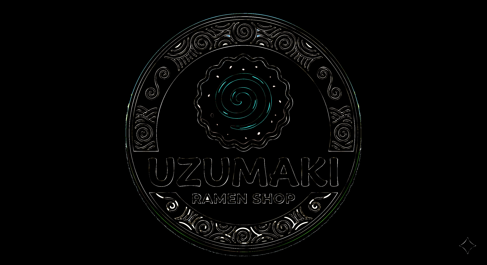

# logo-vectorizer

AI image generators are great at producing logos, icons, and diagrams — but they output rasters.
This tool bridges that gap: give it an AI-generated PNG and it produces a clean, scalable SVG
ready for print, animation, or further editing in Illustrator or Figma.

Converts a raster PNG into a clean multi-layer SVG using divide-and-conquer
least-squares cubic Bézier fitting. No gradient descent — the fit is computed
analytically in a single pass, so there are no spikes and no hyperparameters
to tune.

## Why not Inkscape / Potrace / Adobe Live Trace?

Those tools were designed for hand-drawn line art and simple silhouettes. They work by tracing
a single binary (black/white) mask, so they struggle with:

- **Multi-color logos** — each color layer must be traced independently and stacked
- **AI-generated images** — noisy edges, anti-aliasing, and subtle gradients confuse threshold-based tracers
- **Spike artifacts** — iterative optimizers (e.g. gradient descent on control points) can produce sharp
   unwanted kinks; this tool solves control points analytically, guaranteeing a spike-free result
- __Hyperparameter tuning__ — most tracers expose many interacting knobs; here there is essentially one
   (`MAX_BEZIER_ERR_PX`) that directly maps to "how close is close enough"

png-vectorizer quantizes color first, then fits each color region independently — making it a natural
fit for the flat-color, multi-layer style that AI logo generators tend to produce.

## Example — Uzumaki Ramen Shop

**1. Original raster input** (`uzumaki.png`) — the AI-generated PNG as fed into the tool:


**2. Vectorized SVG** (`uzumaki.svg`) — the output; infinitely scalable, fully editable:


__3. Color-quantized reference__ (`uzumaki_quantized.png`) — the 8-color palette the SVG is matched against:


__4. SVG re-rasterized preview__ (`uzumaki_preview.png`) — the final SVG rendered back to pixels for visual comparison:


__5. 4× pixel diff__ (`uzumaki_diff.png`) — difference between the quantized reference and the SVG preview; bright pixels indicate error:



Command used:

```bash
python src/fit_all.py --input uzumaki.png --output uzumaki.svg \
    --preview uzumaki_preview.png --diff uzumaki_diff.png \
    --colors 8 --flood-bg --min-px 300 --dilation-px 1 --max-bezier-err 2 --corner-coalesce gradient
```

(The defaults have since changed; the command above reproduces that original run.)

## Algorithm

1. **Background removal** — flood-fill from corners to transparent (optional)
2. **Color quantization** — k-means clustering in LAB space → N color layers
3. **Contour tracing** — marching squares per region (outer boundary + holes)
4. **Corner detection** — curvature profile; weak corners coalesced away
5. __D&C Bézier fitting__ — each corner-to-corner arc is fitted with the
   fewest cubic Bézier spans that keep max per-point error ≤ `MAX_BEZIER_ERR_PX`
   (default 2px). Split point at worst-fitting arc position, recurse.
   Control points solved via `np.linalg.lstsq` with chord-length
   parameterization — guaranteed spike-free global optimum.
6. **SVG export** — one `<path>` per region with `fill-rule="evenodd"` for holes;
   preview PNG and pixel-diff PNG written alongside the SVG.

## Setup

```bash
python -m venv .venv && source .venv/bin/activate
pip install -r requirements.txt

# Apple Silicon: optional MLX for GPU-accelerated corner coalescing
pip install mlx
```

## Usage

```bash
# Basic
python fit_all.py --input logo.png --output logo.svg

# Remove background before vectorizing
python fit_all.py --input logo.png --flood-bg

# Tune color count and minimum region size
python fit_all.py --input logo.png --colors 5 --min-px 500

# Custom output names
python fit_all.py --input logo.png --output out.svg --preview out_preview.png --diff out_diff.png
```

## Options

| Flag | Default | Description |
|------|---------|-------------|
| `--input` | `logo-plain-transparent.png` | Input PNG |
| `--output` | `taos_pass1.svg` | Output SVG |
| `--preview` | `taos_pass1_preview.png` | Rasterized SVG preview |
| `--diff` | `taos_pass1_diff.png` | 4× pixel diff vs quantized reference |
| `--colors` | `5` | Number of colors to quantize to |
| `--min-px` | `20` | Ignore regions smaller than this many pixels |
| `--flood-bg` / `--no-flood-bg` | on | Flood-fill background to transparent before vectorizing |
| `--flood-tol` | `40` | RGB tolerance for `--flood-bg` |
| `--shadow-tol` | `0.08` | Hue tolerance for removing background-coloured drop shadows connected to the background; `0` = off |
| `--max-bezier-err` | `1.0` | Max per-point error (px) before a Bézier span splits |
| `--dilation-px` | `0` | Mask dilation before contouring |
| `--corner-coalesce` | `dc` | `dc` (closed-form), `gradient` (original, slow) or `off` |
| `--quiet` | off | Suppress per-region progress output |

## Tunable parameters

At the top of `fit_all.py`:

| Parameter | Default | Effect |
|-----------|---------|--------|
| `N_PIX` | `10` | Max anchor spacing = √2 × N_PIX px |
| `SHARP_THRESH` | `40.0°` | Curvature above this → sharp corner (C0 kink allowed) |
| `MAX_BEZIER_ERR_PX` | `1.0` | Max per-point error before D&C splits a span |
| `DILATION_PX` | `0` | Mask dilation before contouring |

## License

MIT — see [LICENSE](LICENSE).
